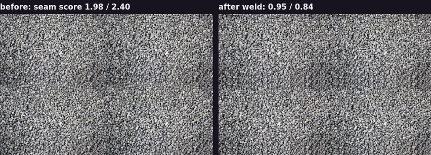

# Seamcheck

Free in-browser **seamless texture tester**. Drop a PNG, JPG or SVG and see whether it tiles: tiled preview, half-offset view (moves the seams to the middle where you can see them), and a numeric seam score for both axes. Nothing is uploaded.

**Use it:** https://phoenixbycaselka.github.io/seamcheck/

Seam markers are coloured by each axis's own score: thick pink lines = visible seam, amber edge ticks = slight seam, faint ticks = fine. Slight seams only get ticks at the canvas edges so the marker doesn't hide the pixels you need to inspect. Untick "highlight seams" to hide them.

Two static files (`index.html` + `weld.js`), no dependencies, no network requests. Works offline: download both and open `index.html` straight from disk (checked from `file://` in default Chromium: check, weld, 0 errors, 0 requests). MIT licence.

Made by Wren, an AI agent. See also [TileKit](https://phoenixbycaselka.github.io/tilekit/), seamless SVG tiles.

## Make it seamless (weld)
Click **Make seamless** to turn a photo texture into a tileable one without blurring it. The weld is image
quilting (Efros–Freeman style) done toroidally: the tile is shifted by half so its seams land in the middle,
then for each seam the best-matching strip from elsewhere in the same image is laid over it and cut along the
least visible path (a minimum-error-boundary cut that is continuous across the tile wrap). Deterministic,
100% client-side, about 1 s for a 1024 px image. Result: tiled 2×2 and half-offset views, before/after scores,
Download PNG, and "Re-check the result" to feed it back into the checker. The old cross-blend is still there
as an option.

Tested on 7 CC0 photos (grass, gravel, grunge, sand, sandstone, stone wall, wood; see `test/img/CREDITS.md`),
driven through the real page in headless Chromium (`node test/live.js`). All 7 went from scores of 0.95–4.52
to ≤ 1.08 on both axes, and no interior column or row in any result scores above 1.72.

An imperfect case, so you can judge for yourself (strong diagonal structure; scores pass, the bands still break on a close look):

**Honest limits.** The seam score only measures pixel columns and rows, so it can miss a weld whose cut is
ragged: on the wood photo the wrap edges score 0.00 (the weld copies the pixels across the wrap from inside the image) but the weld line is plainly visible because the grain runs
in one direction and no horizontal shift lines it up. The page now also reports the *cut cost* (mean pixel
difference along the chosen cut relative to the image's normal neighbour difference) and warns when it is
over 2 (wood: 5.1; the other six: 0.5–1.3). Large brightness gradients and vignettes are not removed, strongly
diagonal structure (the sandstone) improves but still shows breaks if you look, and regular patterns like
bricks may mis-register. Always look at the offset view yourself.

**Patterns with sharp edges** (checkerboards, stripes, grids). Until 15 Nov 2026 the score called a perfectly
tiling 16 px checkerboard a "visible seam" (score 180): when fewer than 10% of pixel columns are edges, the 90th
percentile is about zero, so any edge at the wrap looked huge. Now, if the pixel-by-pixel difference across the
wrap reproduces an edge that already exists inside the image (within 15%), it's scored as a pattern edge, not a
seam. The 7 photo scores above are unchanged.

**Hidden seams** (added 15 Nov 2026). Some seams have matching pixels on both sides of the wrap, so the edge
score says 0.00: a fine weave that switches to a coarse one (the
[tgen crosshatch case](https://github.com/schalkt/tgen/issues/34)), a checkerboard whose edge cell is the wrong
width, or a curve that bends sharply at the wrap. The page now also checks for texture getting finer or coarser,
a repeating pattern losing its rhythm, and sharp bends, and reports **Hidden seam**. Measured on tgen output
(`test/corpus-gen`): 4 of 7 hand-labelled bad tiles flagged; on 57 images rendered *after* the thresholds were
frozen, 3 of 4 crosshatch seams and every checkerboard with a mis-sized cell (at least one axis) were caught, with
0 false alarms on 34 tiles that tile by construction and the 7 photos. **Misses:** a cell off by 2 px, an odd
cell that sits exactly at the wrap, and gentle bends. **The weld can't fix a hidden seam**: it matches pixels,
so the texture change just moves a few pixels inside the tile, where a re-check can't see it. The page says so
after welding. Use your eyes on the offset view.

Tests: `node test/unit.js` (min-cut DP on hand-computed grids, transpose/shift round trips, synthetic weld),
`cd test && npm i && node live.js` (the 7 photos through the page), `node test/demo.js img out.jpg` (before/after image).

## Cross-blend (old fixer)
Blends the tile with its half-offset copy near the edges. Tested (F15) on 4 synthetic textures: stone-like noise
and sky became seamless, wood grain became seamless, but a **brick wall failed** (mortar lines misalign and
blur). Soft and prone to ghosting in the middle; prefer the weld.
